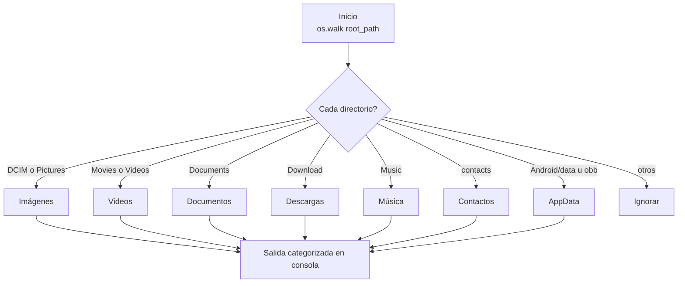

# android-dumper

Script en Python que escanea el almacenamiento de un dispositivo Android y **lista los directorios de datos por categoría** (imágenes, videos, documentos, descargas, música, contactos y datos de aplicaciones).

[](https://python.org)

## Contenido

- [Características](#características)
- [Arquitectura](#arquitectura)
- [Instalación](#instalación)
- [Uso](#uso)
- [Roadmap](#roadmap)
- [Licencia](#licencia)

## Características

- Recorre el árbol de almacenamiento desde la raíz configurable (`/storage/emulated/0` por defecto).
- Clasifica directorios por patrones comunes en Android:
  - **Imágenes**: `DCIM`, `Pictures`.
  - **Videos**: `Movies`, `Videos`.
  - **Documentos**: `Documents`.
  - **Descargas**: `Download`.
  - **Música**: `Music`.
  - **Contactos**: carpetas con `contacts` en el nombre.
  - **AppData**: `Android/data` y `Android/obb`.
- Salida categorizada y legible en consola.
- **Cero dependencias** (solo biblioteca estándar de Python).

## Arquitectura



## Instalación

```bash
git clone https://github.com/bi0punk/android-dumper.git
cd android-dumper
```

## Uso

**Opción A — en el dispositivo (Termux):**

```bash
pkg install python
python app.py
```

**Opción B — almacenamiento montado desde la PC:**

```bash
# Con el dispositivo conectado por USB y depuración activada:
adb pull /storage/emulated/0 ./android-storage
python app.py
# edita root_path en app.py para apuntar a android-storage
```

Puedes cambiar el directorio raíz editando el argumento `root_path` de la función `get_android_data_directories()`.

## Roadmap

- [x] Clasificación de directorios por categoría
- [x] Cero dependencias
- [ ] Guardar el mapa de directorios en un archivo
- [ ] Mostrar tamaño/ocupación por carpeta
- [ ] Interfaz TUI con filtros

## Licencia

Sin archivo `LICENSE` declarado en el repositorio.